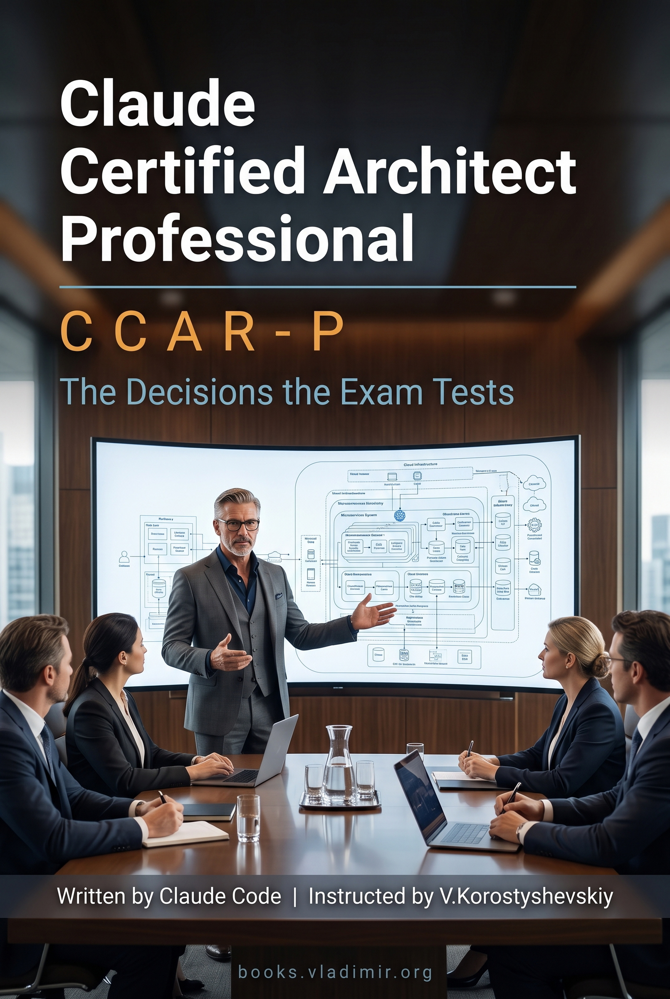

# Claude Certified Architect – Professional (CCAR-P)

### The Decisions the Exam Tests

A practitioner guide for the Anthropic **CCAR-P** certification: 21 chapters, around 80K words, covering all 38 objectives across the seven exam domains. Pattern selection, context strategy, retrieval design, integration surfaces, evaluation, safety and guardrail placement, stakeholder communication, and the lifecycle work that starts after a system ships.

The editorial position is this: the exam tests decisions, not features. Much of what it asks has no documentation page behind it, because it is asking how an architect behaves and not how Claude behaves. So the book argues each decision to the point where the trade-off is visible, on the theory that reasoning transfers to a question nobody has seen and a memorised answer does not.

> **Tested.** I sat CCAR-P on 1 September 2026 and [passed](https://www.credly.com/badges/91687ca6-d512-417b-868a-3dba245c59fe) with a scaled score of 973 against a pass mark of 720, missing 2 questions on the whole exam. This book was the only book I read to understand the material. There were no other books, tutorials or courses.

[**Video overview of the project**](https://youtu.be/2FctIa7_KNY)

## How the chapters are built

Every chapter carries the same apparatus in the same order, so you can open one you have not read and know where you are.

It opens with an italic summary naming the decision at stake and what it costs to get wrong. The headers underneath state their conclusions, which makes the header list inside a chapter a usable summary of it. Anything with parallel structure goes into a table instead of a paragraph. Mistakes get names, in bold. A mistake with a name is one you can recognise among options you are seeing for the first time.

Each chapter then takes apart the way wrong answers are constructed from its own material, and closes that section on a three-column table pairing a signal in the question with the answer it normally points to and the trap it normally conceals. The rows are cues, not worked cases, which is what lets them apply to a situation set in some industry the book never once mentions.

Then a closing list of things to remember, written so each line survives with the chapter shut.

If you are short of time, that closing list is the part to know about. Read all twenty-one of them first, then go back into the chapters behind any line you could not immediately justify.

## Contents

Every chapter below links to its Markdown source. The PDF and EPUB carry the same text.

[**Preface**](./book/chapters/00-preface.md)

**Part I. Before there is an architecture**

1. [What You Are Actually Being Asked to Decide](./book/chapters/01-what-you-are-being-asked-to-decide.md)
2. [Discovery Is Elicitation, Not Conversation](./book/chapters/02-discovery-is-elicitation.md)
3. [Sizing, Scoping, and the Feasibility Verdict](./book/chapters/03-sizing-scoping-feasibility.md)

**Part II. Choosing the shape**

4. [Augmented Call, Workflow, Agent](./book/chapters/04-augmented-call-workflow-agent.md)
5. [When a Second Agent Is a Liability](./book/chapters/05-when-a-second-agent-is-a-liability.md)
6. [Reference Architectures and Retrieval Against Live State](./book/chapters/06-reference-architectures-and-live-state.md)

**Part III. The model and what you feed it**

7. [Model, Context Window, Context Strategy](./book/chapters/07-model-context-window-context-strategy.md)
8. [Prompts as Architecture](./book/chapters/08-prompts-as-architecture.md)

**Part IV. Making it a system**

9. [Chunking, Indexing, and the Query You Did Not Anticipate](./book/chapters/09-chunking-indexing-retrieval.md)
10. [Entry Points, Routes, and the Integration Layer](./book/chapters/10-entry-points-routes-integration.md)

**Part V. Proving it works**

11. [The Numbers Before You Build](./book/chapters/11-the-numbers-before-you-build.md)
12. [Observability at Scale](./book/chapters/12-observability-at-scale.md)
13. [Evals as Acceptance Criteria](./book/chapters/13-evals-as-acceptance-criteria.md)
14. [A/B, Shadow, and Not Overclaiming](./book/chapters/14-ab-shadow-and-not-overclaiming.md)

**Part VI. Governing it**

15. [The Safety Stack, and Where the Guardrails Sit](./book/chapters/15-the-safety-stack-and-guardrail-placement.md)
16. [Human Review by Stakes, Not by Volume](./book/chapters/16-human-review-by-stakes.md)
17. [Proving It to Someone Who Was Not There](./book/chapters/17-proving-it-to-someone-who-was-not-there.md)

**Part VII. Handing it over**

18. [Defending the Design](./book/chapters/18-defending-the-design.md)
19. [Feedback Loops and What You Owe When One Breaks](./book/chapters/19-feedback-loops-and-slas.md)
20. [Documentation That Survives Your Absence](./book/chapters/20-documentation-that-survives.md)

**Part VIII. Enabling the team**

21. [Team Enablement and the Debugging Loop](./book/chapters/21-team-enablement-and-debugging.md)

**Back matter**: [Coverage Map](./book/chapters/95-coverage-map.md) · [Glossary](./book/chapters/96-glossary.md)

## Why the chapters are not in exam order

The published blueprint lists seven domains in a fixed order, and this book does not follow it.

Blueprint order is a filing system. It groups objectives by the department that owns them, which is the correct way to write an exam and the wrong way to learn anything, because it separates decisions that get made in the same meeting and joins decisions that are months apart. Choosing a pattern and sizing the problem are one act, and the blueprint puts them in different bullets. So the chapters run in the order the work happens: what you are being asked to decide, then discovery, then feasibility, then the shape, then the model, then the system, then proof, then governance, then handover, then the team.

An ordering bet like that is only defensible if it costs no coverage, so the book carries a proof of it. The [Coverage Map](./book/chapters/95-coverage-map.md) is generated from the blueprint and from the book's own structure, and it **fails to build if any objective is unclaimed or claimed twice**. The first time it ran, it failed, because two objectives had quietly lost their chapter.

## The seven domains

Weights are the published ones. Read the chapter numbers as where this book spends its pages.

- **Solution Design & Architecture** (17%, Chs [1](./book/chapters/01-what-you-are-being-asked-to-decide.md), [3](./book/chapters/03-sizing-scoping-feasibility.md), [4](./book/chapters/04-augmented-call-workflow-agent.md), [5](./book/chapters/05-when-a-second-agent-is-a-liability.md)): the gap between a business problem and an architecture, which is where most of this domain lives, the one question that selects between an augmented call, a workflow and an agent, why the wrong pattern still works and only bills you later, and the reasons a second agent gets chosen that have nothing to do with the work.
- **Claude Models, Prompting & Context Engineering** (13%, Chs [4](./book/chapters/04-augmented-call-workflow-agent.md), [7](./book/chapters/07-model-context-window-context-strategy.md), [8](./book/chapters/08-prompts-as-architecture.md)): the working-memory cliff, the three things that actually decide a model choice, and a prompt treated as a durable component with a version, a cache key, an ordering dependency and a failure mode instead of as text you tweak.
- **Integration** (19%, Chs [6](./book/chapters/06-reference-architectures-and-live-state.md), [7](./book/chapters/07-model-context-window-context-strategy.md), [9](./book/chapters/09-chunking-indexing-retrieval.md), [10](./book/chapters/10-entry-points-routes-integration.md), [11](./book/chapters/11-the-numbers-before-you-build.md), [12](./book/chapters/12-observability-at-scale.md)): two query shapes with opposite requirements, why live state does not belong in an index, chunk size as the knob that is almost never the problem, and which capabilities an agent holds, when their definitions load, and where authorisation actually sits.
- **Evaluation, Testing & Optimization** (16%, Chs [11](./book/chapters/11-the-numbers-before-you-build.md), [12](./book/chapters/12-observability-at-scale.md), [13](./book/chapters/13-evals-as-acceptance-criteria.md), [14](./book/chapters/14-ab-shadow-and-not-overclaiming.md)): the sensible optimisation applied to a term that was never dominant, the difference between something that reads telemetry and something that produces it, evaluations as the definition of finished agreed before anyone can be embarrassed by the result, the grading ladder, and the 50-session winner.
- **Governance, Safety & Risk Management** (14%, Chs [15](./book/chapters/15-the-safety-stack-and-guardrail-placement.md), [16](./book/chapters/16-human-review-by-stakes.md), [17](./book/chapters/17-proving-it-to-someone-who-was-not-there.md)): the two bars a control has to clear before it counts as a guardrail rather than a preference with good intentions, permission modes and the boundary that gets forgotten, review routed by stakes because volume is unaffordable and convenience is unsafe, and separating the constraint that disqualifies a design from the ones that merely make it expensive.
- **Stakeholder Communication & Lifecycle Management** (14%, Chs [2](./book/chapters/02-discovery-is-elicitation.md), [3](./book/chapters/03-sizing-scoping-feasibility.md), [18](./book/chapters/18-defending-the-design.md), [19](./book/chapters/19-feedback-loops-and-slas.md), [20](./book/chapters/20-documentation-that-survives.md)): the constraint that was true all along and surfaces in week six, the feasibility verdict including a verdict of no, a design review as a test of whether the people who must approve it can tell that it is good, converting an unachievable demand into a measurable target, and documentation judged by whether somebody who was never involved can act on it.
- **Developer Productivity & Operational Enablement** (7%, Ch [21](./book/chapters/21-team-enablement-and-debugging.md)): which layer a setting belongs at given who is supposed to be able to override it, and the debugging loop.

Each chapter names the mistakes that wrong answers are built out of, in bold, because a mistake you can name is one you can recognise in an option list you have never seen.

## How it was made

The corpus is Anthropic's own documentation, downloaded in August 2026: close to 500 pages across the platform, Claude Code and the protocol specification. Plus the published exam guide, version 1.0, July 2026.

Two of my own tools did the gathering.

- [**site2vault**](https://github.com/vkorost/site2vault) mirrored Anthropic's documentation sites into local Obsidian vaults, so the writing read from files instead of paying for web fetches. It also fixes the corpus in place, so the book was written against one specific snapshot and not against whatever the docs happened to say later.
- [**YTubeFetch**](https://github.com/vkorost/ytubefetch) pulled the subtitles from a few dozen YouTube recordings of people describing this exam to each other.

The book itself was assembled with Claude Code using techniques described in [weekend-diy-book](https://github.com/vkorost/weekend-diy-book): per-chapter assembly under explicit constraints, an anti-repetition registry, automated gates on every chapter, multi-pass review, editorial revision, and final DOCX generation. Every claim about how something behaves traces to a documentation page, and the endnote carries that page's own URL, so you are never handed a title you then have to go and search for.

Those YouTube recordings ground no sentence in the book. They were read as a list of topics worth having on the table and never as evidence of anything. What a crowd repeats about an exam is a rumour that has been through a lot of mouths, and the useful response to a rumour is to go and look, not to print it. Where the recordings pointed at something, the book went to the documentation and found out. Where they went quiet on a topic the material clearly covers, that silence was treated as a warning and not as permission to skip it.

## Download

- [**PDF**](https://github.com/vkorost/claude-certified-architect-professional-guide/releases/latest/download/Claude-Certified-Architect-Professional.pdf) - for offline reading and print.
- [**EPUB**](https://github.com/vkorost/claude-certified-architect-professional-guide/releases/latest/download/Claude-Certified-Architect-Professional.epub) - for e-readers.

Both are attached to the [latest release](https://github.com/vkorost/claude-certified-architect-professional-guide/releases/latest) and always point at the current revision. The book is corrected in place instead of re-versioned, so these links do not go stale.

## What's in this repo

- `README.md`: this file.
- `book/chapters/`: every chapter as an individual Markdown file, plus the preface, the coverage map, and the glossary. Endnotes sit at the end of each chapter that has them, with the source URL in the note.
- `book/Claude-Certified-Architect-Professional-Cover.jpg`: the cover.
- [`LICENSE`](./LICENSE): CC BY-NC-SA 4.0.

The PDF and EPUB are attached to the release instead of committed. Both are already-compressed archives that git cannot delta, so committing them would store a near-complete copy per revision and grow the repository permanently.

The documentation vaults, the pipeline, and the working files are not published. Neither is any exam-question material: the credential's exam guide places exam content under NDA, and nothing of that kind appears in this book, in this repository, or in any file linked from it.

## Coverage cutoff

Documentation sources were consulted through August 2026, and the exam guide is version 1.0, effective July 2026. The Claude platform, Claude Code and MCP are under active development, and the model lineup in particular moves faster than any book about it. The text documents behaviour as of its writing date. Verify time-sensitive claims against current documentation before relying on them for a production decision or for the exam.

## AI assistance, scope of

The book was written by Claude Code under my instruction, and the preface says so to the reader in its first sentence instead of burying it down here. The pipeline ran one writer agent per chapter, sequentially, each drafting, self-repairing, and running its own instruments, with the orchestrator re-running every check independently instead of trusting the self-report. Editorial decisions about structure, ordering, framing, and which positions to take were mine. Fact-checking was bounded by the source corpus, and the automated gates are what held that boundary.

## What's not in scope

This is not a Claude Code tutorial, a getting-started guide, a prompt cookbook, or an API reference. It contains no practice questions, no drills, and nothing for you to answer. The reader is assumed to have built something with Claude and to know what a tool call, a context window and an agent loop are. The book does not teach you to use the platform; it teaches you to defend a design built on it, which is what the exam is asking.

If you are after the Foundations credential instead, [claude-certified-architect-guide](https://github.com/vkorost/claude-certified-architect-guide) is the same treatment for CCAR-F: different exam, different blueprint, 12 chapters, built the same way.

## Disclaimer

This repository is an independent, unofficial study guide. It is not produced, endorsed, sponsored, or reviewed by Anthropic. "Claude", "Claude Code" and "Claude Certified Architect" are trademarks of Anthropic, PBC, used here for descriptive reference only.

## Author

I am not employed by Anthropic or any AI vendor. The book was produced independently and represents no company's views. The analytical framework, the named concepts, and the structural argument are original to this work. The facts are drawn from the cited public corpus.

## License

Everything here (the chapter `.md` files, this README, and the cover) is licensed under **Creative Commons Attribution-NonCommercial-ShareAlike 4.0 International (CC BY-NC-SA 4.0)**. See [`LICENSE`](./LICENSE).

You may share and adapt it for non-commercial purposes with attribution. Commercial reuse or redistribution of the written content, including republication as a book, a course, or any paid resource, is not permitted, and any derivative must carry the same license.

---

